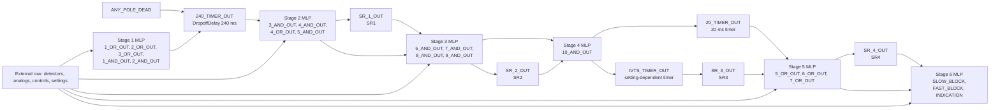
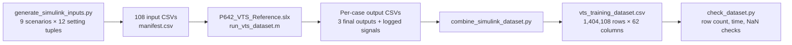

# BTP Presentation Content

## Project title

**Virtual Replication of Voltage Transformer Supervision (VTS) Function in Protection IED using Neural Networks**

## Presentation positioning

This presentation should describe the repository as an engineering prototype and
diagnostic baseline. The saved sequential results do **not** demonstrate
protection-grade equivalence, hardware validation, or independent
generalization.

### Evidence labels used in this document

- **Verified:** directly present in source code, saved metrics, saved reports,
  tests, or the checked-in Simulink workflow.
- **Documented decision:** stated in `decisions.md`, whether or not it was
  experimentally successful.
- **Provisional/unverified:** explicitly marked as such by the repository.
- **Not documented:** no repository evidence was found; do not present it as a
  project decision.
- **Proposed future work:** contained in `INDEPENDENT_TEST_DESIGN.md`, but not
  performed.

## Important implementation clarification: FiLM versus the trained path

The repository contains `src/models/conditional_mlp_film.py`, which defines a
conditional MLP with FiLM:

\[
\operatorname{FiLM}(h,s)=\gamma(s)\odot h+\beta(s)
\]

where `s` is a settings vector and the conditioner produces
`\gamma(s)` and `\beta(s)`. However, the completed six-stage training and
integrated evaluator instantiate `Stage1MLP` through `Stage6MLP` directly.
`VTSStagedModel` does not instantiate `ConditionalMLPFiLM`, and
`train_six_stage_network.py` has no FiLM settings input.

Therefore:

1. FiLM is a repository architecture prototype/intended direction.
2. The recorded trained/evaluated six-stage results are from plain modular
   stage MLPs plus deterministic timers and SR flip-flops.
3. The current results must not be described as measured results of a
   settings-conditioned FiLM model.
4. The project objective of avoiding complete retraining after settings changes
   is not demonstrated by the saved experiments.

This clarification is essential for technical accuracy during evaluation.

---

# Slide 1 — Problem, motivation and objective

## Main message

Protection IED VTS logic is stateful, timed, and settings-dependent. The project
attempts to construct a software replica whose neural components preserve the
relay's staged organization while retaining explicit timing and state.

## Detailed content

- A **Protection Intelligent Electronic Device (IED)** is a digital
  protection controller that receives electrical measurements and status
  signals, applies protection logic, and issues control/protection outputs.
- **Voltage Transformer Supervision (VTS)** detects conditions in which voltage
  transformer measurements are unavailable, abnormal, or inconsistent with the
  electrical operating condition.
- VTS is used so that protection functions do not operate on misleading voltage
  information and so that appropriate block/indication behaviour can be
  produced.
- The repository-specific objective is to replicate the P642 VTS behaviour using
  a neural-network-based implementation while preserving the original signal
  flow and stateful timing behaviour.
- The project README states the intended longer-term goal as adapting to relay
  setting changes without complete retraining.

## Suggested visual

Problem diagram:

`VT measurements + currents + binary controls + settings -> VTS logic -> SLOW_BLOCK / FAST_BLOCK / INDICATION`

Add a warning badge: “Prototype replication; not a protection replacement.”

## Speaker notes

The first motivation is engineering: replacing or virtualizing a complex
logic path can support analysis, software integration, and future adaptation.
The repository does not establish that the replica is safe for deployment.
“Avoid retraining after a setting change” means the learned mapping would
condition on relay settings at inference time instead of requiring a new
complete training run. That capability is an objective/proposed direction,
not a completed result in this repository.

## Sources

- `README.md`, objective and current approach.
- `decisions.md`, D-001, D-007, D-008, D-009.
- `src/models/vts_staged_model.py`, `VTSStagedModel`.

---

# Slide 2 — Reference VTS implementation and engineering baseline

## Main message

Simulink is the behavioural reference; Python is the replication and evaluation
path.

## Detailed content

- Reference model: `models/Simulink/P642_VTS_Reference.slx`.
- MATLAB workflow:
  1. Read generated input CSVs and `manifest.csv`.
  2. Feed `time + 22 input signals` to Simulink.
  3. Extract `SLOW_BLOCK`, `FAST_BLOCK`, and `INDICATION` from `yout`.
  4. Extract detector, timer, intermediate, and SR signals from `logsout`.
  5. Save one complete output CSV per case.
- The checked-in model contains named blocks such as:
  `VAB_Level_Detector`, `VBC_Level_Detector`, `I2_Current_Detector`,
  `240ms_timer_Drop_off`, `tVTS Timer`, `Timer_20ms_Pickup`, and S-R
  flip-flops.
- `docs/vts_signal_flow.csv` records exported top-level connections.

## Suggested visual

Use a MATLAB/Simulink screenshot of the top-level
`P642_VTS_Reference.slx` model. The repository has the `.slx` model and an
export script, but no checked-in presentation screenshot.

## Speaker notes

The reference is not the earlier static Python logic. The decision log
explicitly selects Simulink because the saved dataset was generated from it.
This keeps the comparison tied to the same signal names, timers, and outputs.

## Sources

- `models/Simulink/P642_VTS_Reference.slx`.
- `models/Simulink/run_vts_dataset.m`, main simulation loop.
- `scripts/matlab/export_vts_signal_flow.m`.
- `docs/vts_signal_flow.csv`.
- `decisions.md`, D-001.

---

# Slide 3 — Hybrid six-stage architecture

## Main message

The replica replaces gate groups with six supervised MLP stages, while
stateful timing and SR storage remain deterministic.

## Architecture diagram



## Exact execution order

`Stage 1 -> 240 ms timer -> Stage 2 -> SR1 -> Stage 3 -> SR2 -> Stage 4 -> tVTS timer -> 20 ms timer -> SR3 -> Stage 5 -> SR4 -> Stage 6`

## Speaker notes

This is not one monolithic black-box network. Each stage has named inputs and
outputs corresponding to the logged reference signals. The trade-off is
interpretability and diagnostics versus sequential error propagation.

## Sources

- `src/models/stage1_model.py` through `stage6_model.py`.
- `src/models/vts_staged_model.py`, `VTSStagedModel.step`.
- `decisions.md`, D-007 and D-010.

---

# Slide 4 — Stage-by-stage signal path

## Main message

Each stage maps a specific group of relay signals and exposes intermediate
targets for supervision and diagnosis.

| Stage | Inputs | Outputs | Implementation detail |
|---|---|---|---|
| 1 | `IA_GT`, `IB_GT`, `IC_GT`, `DELTA_IA_GT`, `DELTA_IB_GT`, `DELTA_IC_GT`, `VTS_MANRESET`, `VTS_AUTORESET`, `VAB_GT`, `VBC_GT`, `VTS_BLOCKING`, `ACCELERATE_IND` | `1_OR_OUT`, `2_OR_OUT`, `3_OR_OUT`, `1_AND_OUT`, `2_AND_OUT` | Shared two-hidden-layer MLP; `2_AND_OUT` uses an internal complement of `VTS_BLOCKING`. |
| 2 | `V2`, `I2`, `240_TIMER_OUT`, `1_AND_OUT`, `2_OR_OUT` | `3_AND_OUT`, `4_AND_OUT`, `4_OR_OUT`, `5_AND_OUT` | First network predicts three outputs; `5_AND_OUT` uses predicted `4_OR_OUT`, `NOT(240_TIMER_OUT)`, and `2_OR_OUT`. |
| 3 | `ALL_POLE_DEAD`, `1_OR_OUT`, `4_OR_OUT`, `4_AND_OUT`, `SR_1_OUT`, `3_OR_OUT`, `ANY_VOLTAGE_DEPENDENT_FUNCTION` | `6_AND_OUT`, `7_AND_OUT`, `8_AND_OUT`, `9_AND_OUT` | Separate learned gate subnetworks; explicit complements are applied to reference gate inputs. |
| 4 | `SR_2_OUT`, `6_AND_OUT`, `240_TIMER_OUT`, `2_AND_OUT` | `10_AND_OUT` | Explicit complements of `SR_2_OUT` and `240_TIMER_OUT`. |
| 5 | `SR_3_OUT`, `MCB_VTS_OPTO`/`MCB_VTS`, `8_AND_OUT`, `VTS_TIMER_OUT`, `20_TIMER_OUT` | `5_OR_OUT`, `6_OR_OUT`, `7_OR_OUT` | `6_OR_OUT` consumes predicted `5_OR_OUT`; `7_OR_OUT` uses timer outputs. |
| 6 | `5_OR_OUT`, `6_OR_OUT`, `VTS_BLOCKING`, `MCB_VTS_OPTO`/`MCB_VTS`, `SR_4_OUT` | `SLOW_BLOCK`, `FAST_BLOCK`, `INDICATION` | Three output-specific two-input subnetworks. |

## Speaker notes

The `*_GT` and `*_OK` names are compatibility aliases for logged detector
signals; they are not newly implemented detector physics. Stage 1 receives
Simulink detector outputs in the current integration path. This is a key
limitation when describing what has actually been replicated.

## Sources

- `src/models/stage1_model.py` through `stage6_model.py`.
- `src/models/vts_staged_model.py`, detector aliases and `_predict`.
- `models/Simulink/run_vts_dataset.m`, signal inventory.

---

# Slide 5 — Timers and SR flip-flops

## Main message

Timing and memory are explicit deterministic components rather than
memoryless neural outputs.

## Detailed content

### Timers

1. `timer240`: `DropoffDelay(delay_s=0.240)` driven by `ANY_POLE_DEAD`.
2. `tvts_timer`: setting-dependent `PickupDelay` or `DropoffDelay`, with
   `delay_s = inputs["tVTS"]`.
3. `timer20`: `PickupDelay` or `DropoffDelay(delay_s=0.020)` driven by
   `10_AND_OUT`.

`PickupDelay` turns on after the input remains true for the configured
duration and resets when the input becomes false. `DropoffDelay` turns on
immediately and remains on until the input has been false for the configured
duration.

### SR state

- Four `SRFlipFlop` instances: `sr1`, `sr2`, `sr3`, `sr4`.
- `next_state(set_signal, reset_signal)` computes the next value without
  mutation.
- Reset has priority if Set and Reset are simultaneously true.
- The current synchronized implementation captures all four Set/Reset pairs,
  computes downstream values, and commits all four states at the end of the
  timestep.

## Why not learn them as ordinary MLP outputs?

This is a documented design decision: timers and flip-flops carry explicit
state and duration semantics. Replacing them with row-wise predictions would
discard the timing/state contract that the integrated model is intended to
preserve.

## Speaker notes

The synchronization change was test-verified, but it did not improve the saved
aggregate final metrics. The repository explicitly avoids claiming that every
timer/SR transition is equivalent to the Simulink implementation.

## Sources

- `src/timing/timers.py`, `PickupDelay`, `DropoffDelay`.
- `src/timing/flip_flop.py`, `SRFlipFlop.next_state`.
- `src/models/vts_staged_model.py`, `step`.
- `tests/test_timing.py`, `tests/test_vts_staged_model.py`.
- `decisions.md`, D-008, D-009, D-010 and 2026-11-10 entries.

---

# Slide 6 — Dataset generation and schema

## Main message

Expected labels come from the Simulink reference, not from the Python
surrogate logic.

## Dataset workflow diagram



## Verified dimensions and schema

- 108 cases.
- 13,001 samples per complete case.
- Global sample interval: `DT = 0.001 s`.
- Simulation interval: `0` through `13.0 s`.
- Total rows: `1,404,108`.
- 62 columns:
  - 23 input/time columns;
  - 3 final outputs;
  - 2 metadata columns;
  - 34 logged intermediate signals.
- Simulink runner expects `time + 22 input signals` and checks finite values,
  output sample counts, and logged signal completeness.
- Case 089 was repaired as a single-file artifact; the decision log says the
  other cases were not regenerated.

## Input scenario and setting coverage

Scenarios:

`healthy`, `normal_load_unbalance`, `three_phase_vt_loss_energization`,
`mcb_vts_operation`, `negative_sequence_fault`, `three_phase_fault`,
`two_phase_vt_loss`, `three_phase_vt_loss_under_load`,
`one_phase_vt_loss`.

The generator defines 12 setting tuples covering `VTS_STATUS` 0/1/2, Manual or
Auto reset, delays from 1 to 10 seconds, and listed current-inhibit values.
The generator itself labels some profiles as initial proxies requiring
confirmation against the manual and circuit.

## Important distinction

`src/logic/vts_logic.py` is an earlier static/prototype logic path and
explicitly says it is not the complete time-domain P642 state machine. It is
not the behavioural oracle for the completed training dataset.

## Sources

- `src/data_generation/generate_simulink_inputs.py`.
- `models/Simulink/run_vts_dataset.m`.
- `scripts/dataset/combine_simulink_dataset.py`.
- `scripts/dataset/check_dataset.py`.
- `decisions.md`, D-001 through D-004.

---

# Slide 7 — Split, training method and evaluation contract

## Main message

The models were trained stage-wise with a case-wise split, but the final
system must be evaluated sequentially to reveal propagated errors.

## Training method

- Split by sorted `case_id`, not by individual rows:
  - Training: `case_001`–`case_087`, 87 cases, 1,131,087 rows.
  - Validation: `case_088`–`case_108`, 21 cases, 273,021 rows.
- Seed: `20261104`.
- Device recorded: CPU.
- Loss: `BCEWithLogitsLoss`.
- Optimizer: Adam.
- Learning rate: `1e-3`.
- Batch size: `4096`.
- Maximum epochs: `12`.
- Early-stopping patience: `3`.
- Best checkpoint: lowest validation loss.
- Checkpoints: one `stage*_best.pt` per stage plus `training_metrics.json`.
- Threshold for saved binary stage accuracy: sigmoid probability `>= 0.5`.

## Two evaluation modes

1. **Stage-wise evaluation:** each stage receives its supervised input columns,
   including reference intermediates where applicable.
2. **Integrated sequential evaluation:** `VTSStagedModel.step()` runs one row
   at a time; predictions feed later stages, while timers and SR state evolve.

Stage-wise accuracy therefore measures learned local mappings. Integrated
accuracy measures the complete sequential contract and is the deployment-relevant
measurement in this repository.

## Sources

- `scripts/training/train_six_stage_network.py`.
- `scripts/training/evaluate_integrated_model.py`.
- `models/trained/training_metrics.json`.
- `decisions.md`, D-012 through D-015.

---

# Slide 8 — Intended FiLM architecture versus implemented training path

## Main message

FiLM is mathematically defined in the repository, but it was not used by the
saved six-stage training/evaluation run.

## FiLM explanation

For hidden feature vector \(h\) and setting vector \(s\):

\[
(\gamma(s),\beta(s)) = f_{\text{conditioner}}(s)
\]
\[
h_{\text{conditioned}} = \gamma(s)\odot h+\beta(s)
\]

Conceptually, settings modulate hidden features without changing the base
network weights. This is the intended mechanism for adapting behaviour to
setting values.

## What the repository actually implements

- `ConditionalMLPFiLM`:
  - input `signals`;
  - separate `settings`;
  - `FiLMConditioner` generates scale and shift;
  - three logits as output;
  - identity-like initialization via `gamma = 1 + gamma`.
- Completed path:
  - `Stage1MLP`–`Stage6MLP`;
  - settings/control values appear as ordinary inputs in selected stages or
    affect `tVTS` timer creation;
  - no separate settings vector;
  - no FiLM call in `VTSStagedModel`;
  - no settings-conditioned training loop in `train_six_stage_network.py`.

## Setting-change interpretation

- Changing `tVTS` changes the deterministic timer delay.
- Changing available control/input columns changes the values presented to the
  stage networks.
- Learned parameters do not change at inference.
- The repository does not demonstrate that arbitrary setting changes preserve
  fidelity without retraining.

## Speaker notes

If asked why the title says FiLM, explain that FiLM is an implemented
architecture module/prototype and a stated project direction, whereas the
recorded final six-stage experiment used the plain stage classes. This is a
limitation and an honest boundary of the current evidence, not something to
hide.

## Sources

- `src/models/conditional_mlp_film.py`, `FiLMConditioner`,
  `ConditionalMLPFiLM.forward`.
- `src/models/stage1_model.py` through `stage6_model.py`.
- `src/models/vts_staged_model.py`.
- `scripts/training/train_six_stage_network.py`.
- `decisions.md`, D-007 and D-012.

---

# Slide 9 — Design decisions and alternatives

## Main message

The repository documents a modular hybrid design, but not every alternative
listed below was formally evaluated.

| Approach | Repository-supported advantage/disadvantage | Selection status |
|---|---|---|
| Six modular MLPs | Preserves gate grouping, named intermediate supervision, and diagnostics; sequential errors can propagate. | **Selected and implemented.** |
| One monolithic MLP | Would remove the declared stage grouping and stable intermediate interfaces. | Rejected in D-007 to preserve interpretability; no benchmark recorded. |
| Deterministic timers/SRs | Preserves explicit duration/state semantics. | **Selected and implemented.** |
| Learned timer/SR outputs | Would lose explicit state semantics. | Rejected in D-008/D-009; no benchmark recorded. |
| Conditional MLP + FiLM | Settings can modulate hidden representations through scale/shift. | Implemented as a standalone prototype; not used in saved stage results. |
| LSTM | Could represent sequence state, but no repository comparison or rejection rationale is documented. | **Not documented; do not claim it was experimentally rejected.** |
| Set Transformer | No repository evidence of consideration or comparison. | **Not documented.** |
| Hypernetwork | No repository evidence of consideration or comparison. | **Not documented.** |
| Python static logic as oracle | Does not represent the completed time-domain reference. | Not selected; Simulink is the documented oracle. |

## Decision provenance

- **Documented engineering decisions:** Simulink oracle, case-wise split,
  modular stages, deterministic timing/state, BCE stage training, checkpoint
  preservation, synchronized SR commits.
- **Professor-suggested decisions:** No source in the repository attributes a
  specific decision to the professor. Verify this verbally before presenting.
- **Provisional:** complete timer/SR equivalence, detector physical assumptions,
  independent generalization, and FiLM-based setting adaptation.

## Sources

- `decisions.md`, D-001 through D-015 and dated experiment entries.
- `src/models/conditional_mlp_film.py`.
- `src/logic/vts_logic.py`, prototype warning.

---

# Slide 10 — Training results

## Main message

Local stage mappings achieved high aggregate validation accuracy, but these
numbers are not end-to-end system accuracy.

## Exact saved metrics

| Stage | Outputs | Epochs | Train accuracy | Validation accuracy | Train loss | Validation loss |
|---|---|---:|---:|---:|---:|---:|
| 1 | `1_OR_OUT`, `2_OR_OUT`, `3_OR_OUT`, `1_AND_OUT`, `2_AND_OUT` | 7 | 100.0000% | 90.3304% | 0.000508186 | 0.181454441 |
| 2 | `3_AND_OUT`, `4_AND_OUT`, `4_OR_OUT`, `5_AND_OUT` | 12 | 98.7844% | 100.0000% | 0.020110024 | 0.000202057 |
| 3 | `6_AND_OUT`, `7_AND_OUT`, `8_AND_OUT`, `9_AND_OUT` | 12 | 99.9988% | 100.0000% | 0.000730953 | 0.001192244 |
| 4 | `10_AND_OUT` | 12 | 100.0000% | 100.0000% | 0.000003110 | 0.000001202 |
| 5 | `5_OR_OUT`, `6_OR_OUT`, `7_OR_OUT` | 12 | 100.0000% | 100.0000% | 0.000607369 | 0.000664729 |
| 6 | `SLOW_BLOCK`, `FAST_BLOCK`, `INDICATION` | 12 | 100.0000% | 100.0000% | 0.000531769 | 0.000764229 |

## Graph to generate

Grouped bars: train versus validation accuracy by stage.

Underlying values:

```text
stage,train_accuracy,validation_accuracy
1,100.0000,90.3304
2,98.7844,100.0000
3,99.9988,100.0000
4,100.0000,100.0000
5,100.0000,100.0000
6,100.0000,100.0000
```

## Caveat

Some validation targets have zero positive support. A 100% accuracy on such a
target can be achieved by always predicting zero and is not evidence of
positive-event detection.

## Sources

- `models/trained/training_metrics.json`.
- `BTP_Experimental_Results.md`, section 6.

---

# Slide 11 — Chronological experiments and engineering learning

## Main message

The experiments progressively separated local fit, signal-contract issues,
state-update correctness, class imbalance, and threshold effects.

| Experiment | Change and purpose | Actual result | Interpretation/decision |
|---|---|---|---|
| Baseline integrated evaluation, 2026-11-04 | Existing checkpoints, sequential six-stage model, timers and SRs on 21 validation cases. | `SLOW_BLOCK` 90.1092%, `FAST_BLOCK` 83.5174%, `INDICATION` 78.7522%; high precision, low recall. | Failing end-to-end baseline; investigate propagation. |
| Stage 1 polarity correction | Internal complement only for `2_AND_OUT`; separate corrected Stage 1 checkpoint. | Corrected Stage 1 validation accuracy 90.3304%; integrated metrics and mismatch counts unchanged. | Clarified contract, no end-to-end improvement; original checkpoint preserved. |
| Teacher-forced/RCA diagnostic | Reference intermediates supplied to later stages to isolate local mappings. | Later stages/final outputs can be much better under reference inputs; Stage 1 `1_AND_OUT` showed 51.6521% in the RCA condition. | Strong evidence of sequential propagation and input-contract mismatch; not deployment performance. |
| Class-weighted BCE | Retrain selected stages with moderate positive weights. | Stage 1 validation accuracy 91.9420%; final recall unchanged: 41.3055%, 43.0382%, 46.2968%. | Local accuracy gain did not change sequential decisions; configuration rejected as integrated improvement. |
| Global threshold sweep | Diagnostic thresholds 0.3/0.4/0.5/0.6/0.7 on unchanged probabilities. | 0.3/0.4/0.5 identical. At 0.6/0.7: accuracies 97.4343%, 95.6044%, 86.0773%; recalls 84.7802%, 84.8092%, 64.8135%. | Promising exploratory recall lever, but label-tuned validation result; not an unbiased test or retained deployment threshold. |
| Stage-wise threshold sensitivity | Change one stage threshold at a time to locate leverage. | Only Stage 1 at 0.6 changed aggregate outputs; all other single-stage 0.6 settings matched baseline. | Stage 1 is the dominant threshold-sensitive point in this diagnostic. |
| Synchronized SR updates, 2026-11-10 | Two-phase capture/commit of all four SR next states. | 8 tests passed; compilation passed; post-sync aggregate metrics identical to baseline. | Implementation/test correctness improved; no measured aggregate performance improvement. |

## Sources

- `BTP_Experimental_Results.md`.
- `class_weighted_experiment_report.md`.
- `models/experimental/threshold_analysis/threshold_analysis_report.md`.
- `models/experimental/stagewise_threshold_analysis/stagewise_threshold_analysis_report.md`.
- `decisions.md`, dated evaluation entries.

---

# Slide 12 — Final integrated performance

## Main message

The final saved sequential validation result has very high specificity and
precision but unacceptable false-negative burden for a protection application.

## Post-synchronization result

Evaluated with `stage1_corrected_best.pt` and `stage2_best.pt` through
`stage6_best.pt` on 21 validation cases and 273,021 rows.

| Output | Accuracy | Precision | Recall | F1 | TN | FP | FN | TP |
|---|---:|---:|---:|---:|---:|---:|---:|---:|
| `SLOW_BLOCK` | 90.1092% | 99.9947% | 41.3055% | 58.4618% | 227,014 | 1 | 27,003 | 19,003 |
| `FAST_BLOCK` | 83.5174% | 100.0000% | 43.0382% | 60.1772% | 194,019 | 0 | 45,001 | 34,001 |
| `INDICATION` | 78.7522% | 99.9940% | 46.2968% | 63.2905% | 165,002 | 3 | 58,008 | 50,008 |

## Graphs to generate

1. Grouped bars for integrated accuracy:

```text
output,accuracy
SLOW_BLOCK,90.1092
FAST_BLOCK,83.5174
INDICATION,78.7522
```

2. Precision/recall/F1 grouped bars:

```text
output,precision,recall,f1
SLOW_BLOCK,99.9947,41.3055,58.4618
FAST_BLOCK,100.0000,43.0382,60.1772
INDICATION,99.9940,46.2968,63.2905
```

3. Three confusion-matrix heatmaps using the exact counts above.

## Interpretation

The model almost never asserts an output when the reference is inactive, but
misses many reference-positive timesteps. In protection logic, this
false-negative profile is more important than accuracy alone.

## Sources

- `models/trained/integrated_evaluation_post_sync.json`.
- `BTP_Experimental_Results.md`, sections 7 and 11.
- `decisions.md`, 2026-11-10 post-synchronization evaluation.

---

# Slide 13 — Why local accuracy does not become integrated accuracy

## Main message

The integrated model changes the data distribution seen by downstream stages:
predicted intermediate signals, timer transitions, and SR states replace
reference signals.

## Evidence chain

- Reference-input/teacher-forced evaluation gives later stages reference
  intermediates rather than predicted upstream values.
- Sequential inference passes predictions through the stage chain.
- The saved root-cause analysis reports Stage 1 blocking-polarity differences on
  all 273,021 validation rows.
- Sequential mismatch counts in the RCA:

| Sequential component | Mismatches |
|---|---:|
| Stage 1 | 121,000 |
| Stage 2 | 121,000 |
| Stage 3 | 264,000 |
| Stage 4 | 0 |
| Stage 5 | 215,022 |
| Stage 6 | 130,016 |

- The first recurring divergences were recorded around `t=1.000 s` in cases
  such as `case_097`, followed by downstream divergence.
- The remaining SR3/SR4/timer explanations are explicitly hypotheses, not
  confirmed root causes.

## Suggested visual

Two-lane diagram:

```text
Teacher-forced: reference Stage 1 -> reference Stage 2 -> ... -> output
Sequential:     predicted Stage 1 -> timer/SR -> predicted Stage 2 -> ... -> output
```

Mark the first divergence in red and show propagation into later state.

## Speaker notes

High local scores answer “can this stage map its supplied inputs to its
targets?” They do not answer “does the entire recurrent/stateful computation
follow the reference when every upstream value is predicted?”

## Sources

- `models/trained/teacher_forced_analysis.json`.
- `models/trained/integrated_root_cause_analysis.json`.
- `analyze_teacher_forcing.py`.
- `BTP_Experimental_Results.md`, sections 9–10.

---

# Slide 14 — Generalization audit, limitations and future work

## Main message

The validation split is case-disjoint and has no exact cross-split duplicate
rows, but it is not an independent generalization test.

## Verified audit findings

- Training and validation case IDs are disjoint.
- Exact row-value overlap across all columns except `case_id`: **0 distinct
  shared rows**.
- No conventional fitted normalization or validation-derived preprocessing
  artifact was found.
- The 21 validation cases are still part of the same original 108-case
  generation campaign.
- No `data/independent_test/` directory or designated independent case set
  exists.
- The evaluator is hard-coded to the existing Simulink output directory and
  validation case list.
- Existing archive CSVs are not proven independent test data.

## Proposed, not completed, independent design

`INDEPENDENT_TEST_DESIGN.md` proposes 48 new cases, `case_109`–`case_156`, in
four strata:

1. Analog detector boundaries: 12.
2. Timing and transitions: 12.
3. Binary/control combinations: 12.
4. Combined unseen operating points: 12.

It proposes 16 unseen setting tuples and separate independent input/output
directories. No cases were generated, no MATLAB/Simulink run was performed,
and no independent metrics exist.

## Limitations

- Large end-to-end false-negative counts.
- Stage-wise accuracy is not a substitute for integrated accuracy.
- No independent Simulink test set.
- No hardware-in-the-loop, physical IED, field, noise, latency, throughput, or
  memory validation.
- Detector-derived Stage 1 inputs are logged Simulink signals; the Python path
  does not independently validate detector physics.
- Some generator profiles and static detector assumptions are marked as
  proxies or requiring confirmation.
- Timer/SR transition equivalence is not fully proven.
- Current saved results are from a plain stage-MLP path, not measured FiLM
  conditioning.

## Future work

1. Resolve the Stage 1 signal/polarity contract against Simulink connections.
2. Compare every intermediate and state transition at the first divergence.
3. Calibrate thresholds using a separate calibration set and evaluate once on
   untouched data.
4. Add balanced positive-event, per-case, transition-timing, and scenario-level
   acceptance criteria.
5. Implement and evaluate a genuine FiLM-conditioned settings path if that
   remains the project objective.
6. Generate and evaluate the proposed independent cases through Simulink.
7. Perform hardware/real-time validation only after software fidelity is
   established.

## Sources

- `GENERALIZATION_AUDIT.md`.
- `INDEPENDENT_TEST_DESIGN.md`.
- `BTP_Experimental_Results.md`, sections 10, 12 and 13.

---

# Slide 15 — Conclusion

## Main message

The repository delivers a reproducible hybrid replication framework and a
well-instrumented diagnostic baseline, but not a validated protection-grade
replacement.

## Closing points

- Simulink reference workflow and 62-column dataset contract are established.
- Six modular stage MLPs, deterministic timers, and four SR flip-flops are
  implemented and checkpointed.
- Case-wise training/validation split avoids row-wise temporal leakage.
- The experiments identify sequential propagation and Stage 1 contract issues
  as central investigation targets.
- SR synchronization is test-verified but did not change final aggregate
  metrics.
- Exploratory thresholding improves recall on the same validation labels, but
  it is not an unbiased result and was not promoted as a deployment threshold.
- Independent testing, FiLM-based settings adaptation, hardware validation, and
  protection-grade acceptance remain future work.

## Final sentence for presentation

“The project successfully established the reference-data, staged-model, timing,
state, evaluation, and diagnostic framework; the measured sequential results
also clearly identify the remaining fidelity gap that must be resolved before
claiming a deployable VTS replica.”

## Sources

- `README.md`.
- `BTP_Experimental_Results.md`.
- `GENERALIZATION_AUDIT.md`.
- `decisions.md`.

---

# Recommended diagrams

1. Top-level screenshot of `P642_VTS_Reference.slx`.
2. Six-stage hybrid architecture with timers and SR flip-flops.
3. Simulink-to-CSV-to-training/evaluation dataset workflow.
4. Teacher-forced versus sequential inference lanes with first divergence.
5. FiLM conceptual block showing `settings -> gamma/beta -> hidden features`,
   clearly labelled “prototype/not used in saved six-stage run”.
6. Timing/state diagram for `PickupDelay`, `DropoffDelay`, and synchronized SR
   capture/commit.
7. Signal-flow excerpt using actual names from `docs/vts_signal_flow.csv`.

# Recommended graphs

1. Train versus validation accuracy by stage, using Slide 10 values.
2. Integrated accuracy for `SLOW_BLOCK`, `FAST_BLOCK`, and `INDICATION`.
3. Precision, recall, and F1 grouped comparison.
4. Exact confusion-matrix heatmaps for the three final outputs.
5. Baseline threshold 0.5 versus exploratory threshold 0.6/0.7 for accuracy,
   recall, and F1.
6. Sequential stage mismatch counts:
   `121000, 121000, 264000, 0, 215022, 130016`.
7. Experiment timeline: baseline, polarity correction, class weighting,
   threshold diagnostics, SR synchronization.

# Exact exploratory threshold data

Use this only with an “exploratory validation diagnostic” label:

| Threshold/configuration | `SLOW_BLOCK` accuracy / recall / F1 | `FAST_BLOCK` accuracy / recall / F1 | `INDICATION` accuracy / recall / F1 |
|---|---|---|---|
| All stages at 0.5 | 90.1092% / 41.3055% / 58.4618% | 83.5174% / 43.0382% / 60.1772% | 78.7522% / 46.2968% / 63.2905% |
| All stages at 0.6 | 97.4343% / 84.7802% / 91.7633% | 95.6044% / 84.8092% / 91.7803% | 86.0773% / 64.8135% / 78.6508% |
| All stages at 0.7 | 97.4343% / 84.7802% / 91.7633% | 95.6044% / 84.8092% / 91.7803% | 86.0773% / 64.8135% / 78.6508% |

At 0.6:

- `SLOW_BLOCK`: TP 39,004, TN 227,012, FP 3, FN 7,002.
- `FAST_BLOCK`: TP 67,001, TN 194,019, FP 0, FN 12,001.
- `INDICATION`: TP 70,009, TN 165,000, FP 5, FN 38,007.

These values were selected by inspecting validation labels and therefore cannot
be presented as an unbiased test result.

# Likely technical questions and evidence-based answers

1. **Why is the end-to-end accuracy lower than stage-wise accuracy?**  
   Because sequential inference passes predicted intermediates through
   stateful timers and SR elements; teacher-forcing hides that propagation.

2. **Is FiLM actually used by the final trained model?**  
   Not in the saved six-stage run. `ConditionalMLPFiLM` exists, but the trained
   path uses `Stage1MLP`–`Stage6MLP` directly.

3. **Can settings change without retraining?**  
   The objective is stated, but the saved experiments do not demonstrate
   arbitrary setting adaptation. `tVTS` changes the timer delay; there is no
   measured FiLM-conditioned generalization result.

4. **Why use Simulink as ground truth?**  
   The saved dataset was generated from `P642_VTS_Reference.slx`, and the
   decision log selects it as the behavioural reference.

5. **Why split by cases rather than rows?**  
   Adjacent rows in a waveform are temporally related; row-wise splitting can
   leak near-identical samples.

6. **Why retain timers and flip-flops outside the networks?**  
   They represent explicit timing and state semantics and are deterministic in
   the hybrid design.

7. **What did the Stage 1 correction achieve?**  
   It clarified the polarity contract and produced a separate checkpoint, but
   integrated final metrics did not change.

8. **What did synchronized SR updates achieve?**  
   They passed the focused 8-test verification and preserved reset priority;
   the post-sync aggregate metrics were unchanged.

9. **Why not report the 0.6 threshold as the final result?**  
   It was selected/evaluated against validation labels, so it is an exploratory
   diagnostic rather than an unbiased held-out test.

10. **Was an independent test set generated?**  
    No. The 48-case design is only a proposal.

11. **Are the 100% stage results meaningful?**  
    They show strong aggregate local fit, but several targets have zero positive
    support, so accuracy alone can be misleading.

12. **Was hardware or real-time validation performed?**  
    No saved hardware-in-the-loop, physical-IED, latency, throughput, or memory
    validation exists.

13. **What is the largest current safety concern?**  
    False negatives: 27,003, 45,001, and 58,008 for the three final outputs in
    the post-synchronization sequential validation.

14. **Were LSTM, Set Transformer, or Hypernetwork alternatives benchmarked?**  
    No repository evidence documents such benchmarks or formal rejection
    rationales. They should be described as unverified alternatives.

# Information to verify before presenting

1. Confirm with the supervisor how to describe the relationship between the
   FiLM prototype and the completed plain-stage-MLP experiment.
2. Confirm whether any professor guidance on LSTM, Set Transformer,
   Hypernetwork, or FiLM was given outside the repository; the source files do
   not attribute those decisions.
3. Obtain a readable screenshot/export of the top-level Simulink model and,
   if needed, the relevant detector/timer/SR subsystems.
4. Confirm the exact P642 manual/circuit interpretation of the generator's
   proxy scenarios and detector boundaries before showing them as physical
   relay behaviour.
5. Confirm whether the presentation should show the original baseline
   checkpoint, corrected Stage 1 checkpoint, or post-sync checkpoint as the
   “final” artifact. The latest saved integrated reference is post-sync.
6. Decide whether to include exploratory threshold numbers; if included, label
   every graph as validation diagnostics, not test or deployment performance.
7. Confirm whether a formal acceptance target exists. The repository does not
   define a protection-grade numerical threshold.
8. Do not claim independent testing, hardware validation, FiLM-based measured
   adaptation, or protection-grade equivalence unless new evidence outside this
   repository is supplied.
