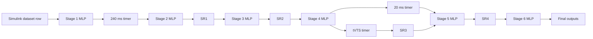

# Engineering Decision Log

This file records meaningful engineering, architectural, implementation, and
experimental decisions for the VTS Protection Relay BTP. Entries are
append-only. Uncertain conclusions are marked as provisional or pending
verification rather than presented as historical fact.

## 2026-11-04 — Current system decisions and evidence

### D-001 — Simulink is the behavioral reference

- **Decision:** Use `P642_VTS_Reference.slx` and its generated CSV outputs as
  the behavioral reference for the neural-network replication.
- **Reason:** The MATLAB runner feeds each generated input waveform to the
  reference model and extracts final outputs plus logged intermediate signals.
- **Alternatives considered:** The Python relay logic and simulator could have
  been treated as the primary oracle, but the available dataset was generated
  from Simulink and the project explicitly preserves that model.
- **Trade-offs:** This preserves fidelity to the reference implementation, but
  requires matching Simulink signal names and timing semantics.
- **Evidence:** `models/Simulink/P642_VTS_Reference.slx`,
  `models/Simulink/run_vts_dataset.m`, and the 62-column output CSVs.
- **Status:** Confirmed for the current dataset.

### D-002 — Generate inputs with one global 1 ms, 13-second time vector

- **Decision:** The input generator uses `DT=0.001`,
  `STOP_TIME=13.0`, and `TIME=np.round(np.arange(0, STOP_TIME + DT/2, DT), 6)`.
- **Reason:** This produces 13,001 samples from 0 through 13 seconds,
  matching the manifest and Simulink runner expectations.
- **Alternatives considered:** Per-case time vectors or the older MATLAB
  five-second prototype existed, but neither matches the completed 108-case
  dataset contract.
- **Trade-offs:** Uniform sampling simplifies training and timing replication,
  while the large fixed dataset costs storage and CPU time.
- **Evidence:** `src/data_generation/generate_simulink_inputs.py:11-13`;
  `models/Simulink/run_vts_dataset.m:143-144`.
- **Status:** Confirmed.

### D-003 — Case 089 was repaired as a single-file artifact

- **Decision:** Repair only `case_089.csv`, its manifest line, and
  `case_089_output.csv`; do not regenerate the other cases.
- **Reason:** Case 089 alone had 2,510 rows and caused its Simulink output to
  stop at 2.509 seconds. Cases 088 and 090 were complete.
- **Alternatives considered:** Regenerating all 108 cases or changing the
  manifest to accept the truncated file were rejected as unsafe and
  unnecessary.
- **Trade-offs:** A surgical repair minimizes collateral changes, but relies on
  the existing generator and reference model remaining unchanged.
- **Evidence:** `repair_case_089_input.py`,
  `models/Simulink/repair_case_089_output.m`, manifest rows 088-090, and the
  successful result of `check_dataset.py`.
- **Status:** Confirmed.

### D-004 — Preserve the 62-column dataset contract

- **Decision:** Keep the 23 input columns, three final outputs, two metadata
  columns, and 34 logged intermediate signals in the existing order.
- **Reason:** The runner writes this schema and downstream combination/training
  code depends on the named columns.
- **Alternatives considered:** Reducing the dataset to final outputs or
  renaming signals for convenience was rejected because it would remove
  supervision and break traceability to Simulink.
- **Trade-offs:** The schema is wide and consumes more memory, but supports
  stage-wise supervision and diagnostics.
- **Evidence:** `models/Simulink/run_vts_dataset.m:30-216`,
  `combine_simulink_dataset.py`, and `case_088_output.csv`.
- **Status:** Confirmed.

### D-005 — Use the logged Simulink detector outputs directly for Stage 1

- **Decision:** Map `IA_GT` to `IA_OK`, `IB_GT` to `IB_OK`, `IC_GT` to
  `IC_OK`, `VAB_GT` to `VAB_OK`, `VBC_GT` to `VBC_OK`, and each
  `DELTA_*_GT` to the corresponding `DELTA_*_OK` column.
- **Reason:** These are the detector-derived signals explicitly identified as
  the Stage 1 inputs; duplicating detector logic would introduce an unverified
  second implementation.
- **Alternatives considered:** Recomputing detectors from analog inputs or
  deriving thresholds in Python was rejected.
- **Trade-offs:** Direct logged-signal reuse maximizes reference consistency,
  but Stage 1 depends on intermediate labels produced by Simulink.
- **Evidence:** `stage1_model.py`, `run_vts_dataset.m`, dataset columns, and
  `VTSStagedModel.step()` alias mapping.
- **Status:** Confirmed by project decision; exact detector internals remain
  owned by Simulink.

### D-006 — Map reset/blocking/control inputs to their existing columns

- **Decision:** Use `VTS_MANRESET`, `VTS_AUTORESET`, `VTS_BLOCKING`, and
  `ACCELERATE_IND` from the dataset. Derive only the logical complement
  `NOT_VTS_BLOCKING = 1 - VTS_BLOCKING` required by Stage 1.
- **Reason:** The reference model exposes `VTS_BLOCKING` and the Stage 1
  architecture explicitly requires its negation; the other three names are
  direct dataset inputs.
- **Alternatives considered:** Adding a new dataset column or training a
  separate negation model was rejected.
- **Trade-offs:** The complement is deterministic and transparent, but the
  Python integration has to keep the alias synchronized with the reference
  polarity.
- **Evidence:** `stage1_model.py`, `vts_staged_model.py`, and the Simulink root
  connections inspected from `P642_VTS_Reference.slx`.
- **Status:** Confirmed.

### D-007 — Six MLP stages replace combinational gate groups

- **Decision:** Preserve six existing MLP classes and their declared
  input/output names:
  Stage 1 (`1_*`, `2_*`, `3_*`), Stage 2 (`3_AND` through `5_AND`),
  Stage 3 (`6_AND` through `9_AND`), Stage 4 (`10_AND`), Stage 5
  (`5_OR` through `7_OR`), and Stage 6 (the three final outputs).
- **Reason:** Each class already encodes the intended gate grouping and
  exposes a stable supervised target interface.
- **Alternatives considered:** Replacing the stages with one monolithic MLP or
  changing hidden architectures was rejected to preserve interpretability and
  stage-wise supervision.
- **Trade-offs:** Modular stages support diagnostics and targeted retraining,
  but sequential errors can propagate through the integrated model.
- **Evidence:** `src/models/stage1_model.py` through `stage6_model.py`,
  `src/models/vts_staged_model.py`, and the logged signal inventory.
- **Status:** Confirmed architecture; end-to-end fidelity is pending evaluation.

### D-008 — Timers remain deterministic and outside the neural networks

- **Decision:** Use `PickupDelay` and `DropoffDelay` for the 240 ms, 20 ms,
  and setting-dependent tVTS timers instead of learning timer state.
- **Reason:** Timers are stateful timing mechanisms with explicit sample-time
  and delay semantics; keeping them deterministic avoids approximating duration
  with a memoryless MLP.
- **Alternatives considered:** Feeding elapsed time into an MLP or learning
  timer outputs as ordinary labels was rejected for the integrated model.
- **Trade-offs:** Deterministic timing improves interpretability and exactness,
  but requires the correct pickup/drop-off mode and reset behavior.
- **Evidence:** `src/timing/timers.py`, `vts_staged_model.py`, and the Simulink
  blocks `240ms_timer_Drop_off`, `Timer_20ms_Pickup`, and `tVTS Timer`.
- **Status:** Timer classes confirmed; complete equivalence of every mode is
  pending end-to-end evaluation.

### D-009 — SR flip-flops remain deterministic state holders

- **Decision:** Use four `SRFlipFlop` instances outside the neural networks,
  with reset-priority behavior.
- **Reason:** Flip-flops carry state across timesteps and are explicitly
  represented as four logged signals.
- **Alternatives considered:** Predicting flip-flop outputs as independent
  neural outputs was rejected because it loses state semantics.
- **Trade-offs:** Explicit state is interpretable and efficient, but the
  set/reset polarity must match the reference connections.
- **Evidence:** `src/timing/flip_flop.py`, `vts_staged_model.py`, the four
  `SR_*_OUT` dataset columns, and Simulink root connections.
- **Status:** Provisional pending full end-to-end comparison.

### D-010 — Established integration order

- **Decision:** Execute Stage 1, 240 ms timer, Stage 2, SR1, Stage 3, SR2,
  Stage 4, tVTS timer, 20 ms timer, SR3, Stage 5, SR4, then Stage 6.
- **Reason:** This is the dependency order encoded by `VTSStagedModel.step()`
  and the Simulink connections.
- **Alternatives considered:** Running all stages in parallel or moving timer
  updates into MLPs was rejected because downstream inputs depend on upstream
  results and state.
- **Trade-offs:** Sequential execution matches the control flow but is slower
  than vectorized independent stage inference.
- **Evidence:** `src/models/vts_staged_model.py`, `run_vts_dataset.m`, and the
  inspected Simulink root line connections.
- **Status:** Confirmed wiring; output fidelity pending evaluation.

### D-011 — Stage 5 uses the actual 20 ms timer name

- **Decision:** Use `20_TIMER_OUT`, not the stale `10_TIMER_OUT` name in the
  original Stage 5 declaration.
- **Reason:** The dataset and reference runner expose `20_TIMER_OUT`, and the
  Simulink model contains `Timer_20ms_Pickup`.
- **Alternatives considered:** Adding a nonexistent `10_TIMER_OUT` alias was
  rejected.
- **Trade-offs:** Correct naming removes a runtime mismatch, but changes the
  public constant in `stage5_model.py` and requires compatible integration code.
- **Evidence:** `stage5_model.py`, `vts_staged_model.py`, `run_vts_dataset.m`,
  and the 62-column output schema.
- **Status:** Confirmed.

### D-012 — Train each stage with supervised binary logits

- **Decision:** Train each stage against its corresponding logged Simulink
  outputs using `BCEWithLogitsLoss`, Adam, bounded epochs, and early stopping.
- **Reason:** All gate/timer/flip-flop/final labels are binary, and logits avoid
  an extra sigmoid inside the loss.
- **Alternatives considered:** MSE, multiclass loss, or a single end-to-end
  loss were rejected for the stage-wise training run.
- **Trade-offs:** Stage-wise BCE is stable and diagnosable, but it does not
  guarantee integrated end-to-end accuracy.
- **Evidence:** `train_six_stage_network.py`, stage output lists, and
  `training_metrics.json`.
- **Status:** Confirmed for the completed training run.

### D-013 — Split by case ID to prevent temporal leakage

- **Decision:** Train on cases 001-087 and validate on cases 088-108, as
  recorded in the training metrics.
- **Reason:** Rows within a case are adjacent samples from one waveform; a
  row-wise random split would leak nearly identical temporal samples.
- **Alternatives considered:** Random row splitting was rejected.
- **Trade-offs:** Case-wise validation is more honest but leaves fewer
  independent validation scenarios and is sensitive to case ordering.
- **Evidence:** `train_six_stage_network.py` and
  `models/trained/training_metrics.json`.
- **Status:** Confirmed for this experiment; stratified case selection is a
  possible future improvement.

### D-014 — Preserve checkpoints and metrics as experiment artifacts

- **Decision:** Save one best checkpoint per stage and one JSON training
  history/metrics file under `models/trained/`.
- **Reason:** Reproducibility requires retaining the selected state, split,
  device, losses, and accuracies.
- **Alternatives considered:** Saving only final weights or relying on console
  output was rejected.
- **Trade-offs:** This consumes modest storage but makes later evaluation and
  rollback possible.
- **Evidence:** `models/trained/stage*_best.pt` and
  `models/trained/training_metrics.json`.
- **Status:** Confirmed.

### D-015 — Current training result

- **Decision:** Retain the completed CPU training run as the baseline.
- **Reason:** It completed successfully without retraining or dataset changes.
- **Alternatives considered:** Immediate retraining was deferred until
  integrated evaluation identifies a concrete deficiency.
- **Trade-offs:** Stage 1 validation accuracy is lower than the other stages,
  and stage-wise accuracy does not establish system accuracy.
- **Evidence:** `training_metrics.json`: Stage 1 90.33% validation accuracy;
  Stage 2-6 100% validation accuracy; validation losses are recorded there.
- **Status:** Confirmed baseline; system-level result pending.

## Execution flow

### Dataset preparation and reference-output flow

1. `src/data_generation/generate_simulink_inputs.py` defines `TIME`,
   `SIGNALS`, `SCENARIOS`, `SETTING_CONFIGS`, and `make_case()`.
2. Its batch loop calls `make_case()` and writes input CSVs and `manifest.csv`.
   The repaired workflow uses `repair_case_089_input.py`, which AST-selects
   only imports, `DT`, `STOP_TIME`, `TIME`, `SIGNALS`, and `make_case()`;
   it does not execute the batch loop.
3. `models/Simulink/run_vts_dataset.m` reads each manifest input, sets
   `SimulationInput.input_data`, sets `StopTime` from `T.time(end)`, and calls
   `sim()`.
4. It extracts `yout{1}`, `yout{2}`, and `yout{3}` as the three final outputs,
   reads `simOut.logsout`, and appends the 34 logged signals.
5. `combine_simulink_dataset.py` concatenates the 108 output CSVs into
   `data/simulink_dataset/vts_training_dataset.csv`.

### Training flow

1. `train_six_stage_network.py` reads only `case_id` to establish the
   case-wise split, then reads only the required columns for each stage.
2. It constructs the corresponding `Stage*MLP`, creates tensor datasets and
   loaders, trains with Adam and `BCEWithLogitsLoss`, evaluates each epoch,
   retains the lowest validation-loss state, and writes the checkpoint.
3. It writes all histories and split metadata to
   `models/trained/training_metrics.json`.

### Integrated inference flow

1. A caller constructs `VTSStagedModel` and calls `step(inputs)` once per
   timestep after `reset()`.
2. `step()` aliases the logged detector outputs to Stage 1 names and derives
   `NOT_VTS_BLOCKING`.
3. Stage 1 predicts five outputs.
4. The 240 ms drop-off timer updates; Stage 2 predicts four outputs.
5. SR1 updates; Stage 3 predicts four outputs; SR2 updates.
6. Stage 4 predicts `10_AND_OUT`; tVTS and 20 ms timers update.
7. SR3 updates; Stage 5 predicts three OR outputs; SR4 updates.
8. Stage 6 predicts `SLOW_BLOCK`, `FAST_BLOCK`, and `INDICATION`.
9. `evaluate_integrated_model.py` loads all six `stage*_best.pt` files and
   applies this sequence to every row of validation cases 088-108, saving
   per-output and per-row mismatches to
   `models/trained/integrated_evaluation.json`.

## Evaluation records

### 2026-11-04 — Integrated checkpoint evaluation

- **Decision:** Evaluate the existing six checkpoints on validation cases
  088-108 without retraining or regenerating data.
- **Reason:** Stage-wise metrics alone do not measure error propagation through
  timers, flip-flops, and downstream stages.
- **Alternatives considered:** Reusing stage-wise validation accuracy or
  evaluating only a small batch was rejected for this milestone.
- **Trade-offs:** Full case-wise sequential inference is slower, but reports
  actual system-level output accuracy and exact mismatches.
- **Evidence:** `evaluate_integrated_model.py`, the saved training split, and
  the resulting `models/trained/integrated_evaluation.json`.
- **Result:** The 21 validation cases were evaluated sequentially, using
  273,021 rows. `SLOW_BLOCK` accuracy was 90.1092% with 27,004 mismatches;
  `FAST_BLOCK` accuracy was 83.5174% with 45,001 mismatches; and
  `INDICATION` accuracy was 78.7522% with 58,011 mismatches.
- **Status:** Completed, but the integrated model does not yet meet a
  correctness target. Stage-wise validation accuracy is therefore not a
  substitute for end-to-end accuracy.

### 2026-11-04 — End-to-end mismatch follow-up

- **Decision:** Treat the integrated evaluation as a failing baseline rather
  than claim successful system replication.
- **Reason:** The final-output mismatches are material despite high
  stage-wise validation scores, demonstrating error propagation or a
  discrepancy in sequential state/timing behavior.
- **Alternatives considered:** Reporting only the 100% Stage 2-6 metrics or
  treating binary outputs as sufficient was rejected because neither measures
  agreement with the Simulink final outputs.
- **Trade-offs:** Keeping the baseline artifacts preserves reproducibility and
  makes debugging possible, but further training or architectural changes
  should wait until the mismatch source is isolated.
- **Evidence:** `models/trained/integrated_evaluation.json` and the console
  result from `evaluate_integrated_model.py`.
- **Status:** Confirmed baseline failure; root-cause analysis is pending.

## Permanent update policy

For every future meaningful architectural, algorithmic, implementation,
configuration, or experimental decision:

1. Add a dated append-only entry here in the same task.
2. State the decision, reason, alternatives, trade-offs, evidence, and status.
3. Name affected files and record relevant test or experiment results.
4. Preserve prior entries; do not silently rewrite or remove history.
5. Mark unresolved concerns explicitly and update their status only when
   evidence is collected.
